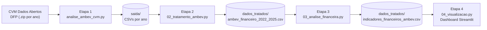

# Análise Financeira da Ambev S.A. (ABEV3)

**Projeto Integrador III** — pipeline de dados e dashboard interativo para análise das demonstrações financeiras da Ambev entre 2022 e 2025, construído sobre os dados abertos da CVM.


> 🔗 **Dashboard online:** _[inserir o link do Streamlit Cloud aqui]_

---

## Sumário

1. [Visão geral](#1-visão-geral)
2. [Dashboard](#2-dashboard)
3. [Fonte dos dados](#3-fonte-dos-dados)
4. [Arquitetura do pipeline](#4-arquitetura-do-pipeline)
5. [Estrutura do repositório](#5-estrutura-do-repositório)
6. [Indicadores calculados](#6-indicadores-calculados)
7. [Decisões metodológicas e controles de qualidade](#7-decisões-metodológicas-e-controles-de-qualidade)
8. [Como executar](#8-como-executar)
9. [Deploy no Streamlit Cloud](#9-deploy-no-streamlit-cloud)
10. [Principais resultados](#10-principais-resultados)
11. [Limitações e próximos passos](#11-limitações-e-próximos-passos)
12. [Tecnologias](#12-tecnologias)
13. [Autores](#13-autores)
14. [Aviso legal e referências](#14-aviso-legal-e-referências)

---

## 1. Visão geral

O projeto automatiza, de ponta a ponta, a análise fundamentalista da Ambev:

- **coleta** das Demonstrações Financeiras Padronizadas (DFP) diretamente do portal de dados abertos da CVM;
- **tratamento** dos demonstrativos consolidados (DRE, Balanço Patrimonial Ativo e Passivo);
- **cálculo** de indicadores de liquidez, rentabilidade, endividamento e crescimento, além de análises horizontal e vertical;
- **visualização** em um dashboard interativo em Streamlit, com filtros por ano e download dos dados.

O foco é a **reprodutibilidade e a confiabilidade dos números**: cada etapa registra logs, valida as contas capturadas e confere identidades contábeis (por exemplo, Ativo Total = Passivo Total).

## 2. Dashboard

O dashboard (`code/04_visualizacao.py`) apresenta:

| Seção | Conteúdo |
|---|---|
| **Indicadores principais** | Receita líquida, lucro líquido, ROE e liquidez corrente do último ano selecionado |
| **Resultados** | Receita e lucro por ano; crescimento anual da receita e do lucro |
| **Rentabilidade** | Evolução das margens (bruta, operacional e líquida); ROA × ROE |
| **Liquidez e endividamento** | Liquidez corrente e seca (com referência = 1); endividamento geral; capital de terceiros / patrimônio líquido |
| **Dados** | Tabela completa dos indicadores e download em CSV dos dados filtrados |

A barra lateral permite selecionar os anos exibidos.

## 3. Fonte dos dados

- **Origem:** [CVM — Dados Abertos, Companhias Abertas, DFP](https://dados.cvm.gov.br/dataset/cia_aberta-doc-dfp)
- **Empresa:** Ambev S.A. (código CVM `23264`)
- **Período:** exercícios de 2022 a 2025
- **Demonstrativos usados:** DRE, BPA e BPP, todos na versão **consolidada**
- **Download:** `https://dados.cvm.gov.br/dados/CIA_ABERTA/DOC/DFP/DADOS/dfp_cia_aberta_{ano}.zip`

Os arquivos brutos ficam em cache local (`dados_cvm/`), então a coleta só baixa o que ainda não existe.

## 4. Arquitetura do pipeline



| Etapa | Script | Entrada | Saída |
|---|---|---|---|
| 1. Coleta | `analise_ambev_cvm.py` | ZIPs da CVM | `saida/ambev_{dre,ativo,passivo,fluxo_caixa}_{ano}.csv` e consolidados 2022–2025 |
| 2. Tratamento | `02_tratamento_ambev.py` | `saida/` | `ambev_financeiro_2022_2025.csv`, bases limpas e `relatorio_qualidade.csv` |
| 3. Indicadores | `03_analise_financeira.py` | tabela da Etapa 2 | `indicadores_financeiros_ambev.csv`, `analise_horizontal_ambev.csv`, `analise_vertical_ambev.csv`, `resumo_analise_ambev.csv` |
| 4. Dashboard | `04_visualizacao.py` | `indicadores_financeiros_ambev.csv` | aplicação Streamlit |

O `run_pipeline.py` executa as etapas 1 a 3 em ordem e confere, antes e depois de cada uma, se o arquivo contém o código da etapa correta e se as saídas foram geradas.

## 5. Estrutura do repositório

```
.
├── code/
│   ├── config.py                  # constantes, caminhos e plano de contas da CVM
│   ├── analise_ambev_cvm.py       # Etapa 1 — coleta (download e extração)
│   ├── 02_tratamento_ambev.py     # Etapa 2 — limpeza e tabela financeira
│   ├── 03_analise_financeira.py   # Etapa 3 — indicadores e análises
│   ├── 04_visualizacao.py         # Etapa 4 — dashboard Streamlit
│   ├── run_pipeline.py            # orquestra as etapas 1–3 com validações
│   └── preparar_deploy.py         # prepara o repositório para o deploy
├── dados_tratados/
│   └── indicadores_financeiros_ambev.csv   # base usada pelo dashboard
├── requirements.txt
└── README.md
```

As pastas `dados_cvm/` (ZIPs brutos), `saida/` (CSVs intermediários) e os demais arquivos de `dados_tratados/` são **regenerados pelo pipeline** e não são versionados (ver `.gitignore`). Apenas o CSV de indicadores é versionado, pois o dashboard publicado depende dele.

## 6. Indicadores calculados

| Grupo | Indicador | Fórmula |
|---|---|---|
| Liquidez | Liquidez corrente | Ativo circulante ÷ Passivo circulante |
| Liquidez | Liquidez seca | (Ativo circulante − Estoques) ÷ Passivo circulante |
| Rentabilidade | Margem bruta | Lucro bruto ÷ Receita líquida |
| Rentabilidade | Margem operacional | Resultado operacional (EBIT) ÷ Receita líquida |
| Rentabilidade | Margem líquida | Lucro líquido ÷ Receita líquida |
| Rentabilidade | ROA | Lucro líquido ÷ Ativo total |
| Rentabilidade | ROE | Lucro líquido ÷ Patrimônio líquido |
| Endividamento | Endividamento geral | Passivo exigível (circulante + não circulante) ÷ Ativo total |
| Endividamento | Capital de terceiros / PL | Passivo exigível ÷ Patrimônio líquido |
| Crescimento | Crescimento anual | Variação percentual ano contra ano (receita, lucro bruto, lucro líquido, ativo e PL) |

Além disso, o pipeline gera:

- **Análise horizontal:** variação percentual de cada conta entre anos consecutivos;
- **Análise vertical:** peso do lucro bruto, do resultado operacional e do lucro líquido sobre a receita líquida;
- **Resumo do período:** valor inicial, valor final e variação acumulada de cada indicador-chave.

## 7. Decisões metodológicas e controles de qualidade

**Exercício correto.** Cada DFP traz, na mesma tabela, o exercício atual (`ORDEM_EXERC = "ÚLTIMO"`) e o comparativo do ano anterior (`"PENÚLTIMO"`). O pipeline mantém somente o `ÚLTIMO`; sem esse filtro, os valores de um ano são substituídos pelos do ano anterior.

**Seleção de contas por código, não por texto.** As contas são localizadas pelo `CD_CONTA` do plano de contas padronizado da CVM, e não por busca em `DS_CONTA` (que pode casar várias contas com a mesma palavra):

| Indicador | `CD_CONTA` | Conta |
|---|---|---|
| `receita_liquida` | 3.01 | Receita de venda de bens e/ou serviços |
| `custo_vendas` | 3.02 | Custo dos bens e/ou serviços vendidos |
| `lucro_bruto` | 3.03 | Resultado bruto |
| `resultado_operacional` | 3.05 | Resultado antes do resultado financeiro e dos tributos (EBIT) |
| `lucro_liquido` | 3.11 | Lucro/prejuízo consolidado do período |
| `ativo_total` | 1 | Ativo total |
| `ativo_circulante` | 1.01 | Ativo circulante |
| `caixa_equivalentes` | 1.01.01 | Caixa e equivalentes de caixa |
| `estoques` | 1.01.04 | Estoques |
| `passivo_total` | 2 | Passivo total (inclui o patrimônio líquido) |
| `passivo_circulante` | 2.01 | Passivo circulante |
| `passivo_nao_circulante` | 2.02 | Passivo não circulante |
| `patrimonio_liquido` | 2.03 | Patrimônio líquido consolidado |

Os códigos seguem a estrutura padronizada da CVM; a conta de estoques (1.01.04) deve ser conferida a cada novo ano de dados.

**Escala monetária.** As DFPs informam os valores em R$ mil (`ESCALA_MOEDA = MIL`). A Etapa 2 converte tudo para **reais**, de modo que receita e lucro apareçam corretamente (por exemplo, R$ 79,7 bi, e não R$ 79,7 mi).

**Demonstrações consolidadas.** Apenas o grupo consolidado é utilizado.

**Lucro bruto derivado.** Se a linha 3.03 não vier na DFP, o lucro bruto é calculado como `receita_liquida + custo_vendas` (o custo já é negativo na CVM), com aviso no log.

**Validações contábeis automáticas (Etapa 2):**

- `Ativo total ≈ Passivo total` (tolerância de 1%);
- `Passivo circulante + Passivo não circulante + Patrimônio líquido ≈ Passivo total`;
- alerta quando uma conta não é encontrada ou quando sobra mais de um valor por ano e indicador.

**Endividamento.** O numerador usa o **passivo exigível** (circulante + não circulante). O passivo total da CVM inclui o patrimônio líquido e, por identidade contábil, é sempre igual ao ativo, o que resultaria em 100% em todos os anos.

## 8. Como executar

### Pré-requisitos

- Python 3.10 ou superior
- Git
- Conexão com a internet (apenas na Etapa 1)

### Instalação

```bash
git clone https://github.com/<usuario>/<repositorio>.git
cd <repositorio>

python -m venv .venv
# Windows (PowerShell):
.venv\Scripts\Activate.ps1
# Linux/macOS:
source .venv/bin/activate

pip install -r requirements.txt requests
```

### Rodando o pipeline completo

```bash
python code/run_pipeline.py
```

Se os dados brutos da CVM já foram baixados (pasta `saida/` preenchida), pule a coleta:

```bash
python code/run_pipeline.py --sem-coleta
```

Também é possível executar cada etapa isoladamente, na ordem:

```bash
python code/analise_ambev_cvm.py
python code/02_tratamento_ambev.py
python code/03_analise_financeira.py
```

### Abrindo o dashboard

```bash
streamlit run code/04_visualizacao.py
```

O dashboard abre em `http://localhost:8501`.

## 9. Deploy no Streamlit Cloud

1. Gere e confira o CSV de indicadores: `python code/run_pipeline.py --sem-coleta`.
2. Prepare o repositório (atualiza `requirements.txt` e `.gitignore`, faz commit e push):

   ```bash
   python code/preparar_deploy.py
   ```

3. Em [share.streamlit.io](https://share.streamlit.io), entre com a conta do GitHub e clique em **New app**.
4. Selecione o repositório e a branch, e informe:
   - **Main file path:** `code/04_visualizacao.py`
   - **Advanced settings → Python version:** 3.12
5. Clique em **Deploy**.

Para atualizar o dashboard depois de reexecutar o pipeline, faça commit do novo `indicadores_financeiros_ambev.csv` e `git push`.

## 10. Principais resultados

Indicadores de rentabilidade calculados a partir das DFPs consolidadas (valores em R$ bilhões):

| Ano | Receita líquida | Lucro líquido | Margem bruta | Margem operacional | Margem líquida | ROE |
|---|---|---|---|---|---|---|
| 2022 | 79,71 | 14,89 | 49,3% | 22,2% | 18,7% | 17,9% |
| 2023 | 79,74 | 14,96 | 50,7% | 23,4% | 18,8% | 18,7% |
| 2024 | 89,45 | 14,85 | 51,2% | 24,4% | 16,6% | 14,9% |
| 2025 | 88,24 | 15,99 | 51,4% | 26,5% | 18,1% | 18,0% |

Em síntese: a margem bruta e a margem operacional avançam de forma consistente no período, enquanto a margem líquida e o ROE oscilam, com queda em 2024 e recuperação em 2025. O lucro líquido é o consolidado do período (inclui participação de não controladores) e o ROE usa o patrimônio líquido consolidado. Os demais indicadores (liquidez, endividamento e ROA) estão disponíveis no dashboard e no arquivo `indicadores_financeiros_ambev.csv`.

## 11. Limitações e próximos passos

**Limitações**

- **Amostra pequena:** são apenas quatro observações anuais; a análise é descritiva e não sustenta inferência estatística ou projeções.
- **Valores nominais:** não há ajuste pela inflação (IPCA), o que pode superestimar o crescimento real.
- **ROA e ROE sobre saldo final:** o cálculo usa o saldo de fim de período, e não a média entre o início e o fim do ano.
- **EBITDA e dívida líquida/EBITDA** não são calculados, pois dependem da depreciação e amortização (DFC) e da abertura da dívida bruta.
- **Sem modelagem preditiva:** o projeto é de análise fundamentalista; não há modelo de previsão.

**Próximos passos**

- Incorporar as ITRs (dados trimestrais) para aumentar a granularidade da série.
- Deflacionar os valores pelo IPCA e calcular crescimento real.
- Adicionar o fluxo de caixa (DFC) para EBITDA, dívida líquida e geração de caixa.
- Integrar preços de ABEV3 (retornos logarítmicos, volatilidade, índice de Sharpe e *drawdown* máximo) e confrontá-los com os fundamentos.
- Comparar com empresas pares do setor.
- Cobrir as etapas do pipeline com testes automatizados.

## 12. Tecnologias

- **Python** — linguagem principal
- **pandas** e **NumPy** — tratamento e cálculo dos indicadores
- **Requests** — download dos arquivos da CVM
- **Plotly** — gráficos interativos
- **Streamlit** — dashboard e hospedagem (Streamlit Community Cloud)
- **Git/GitHub** — versionamento

## 13. Autores

_[Inserir nomes dos integrantes do grupo, curso e instituição]_

## 14. Aviso legal e referências

Este é um projeto **acadêmico**, desenvolvido para fins educacionais. As análises e os indicadores apresentados **não constituem recomendação de investimento**.

**Referências**

- CVM — [Dados Abertos: DFP — Demonstrações Financeiras Padronizadas](https://dados.cvm.gov.br/dataset/cia_aberta-doc-dfp)
- [Documentação do Streamlit](https://docs.streamlit.io)
