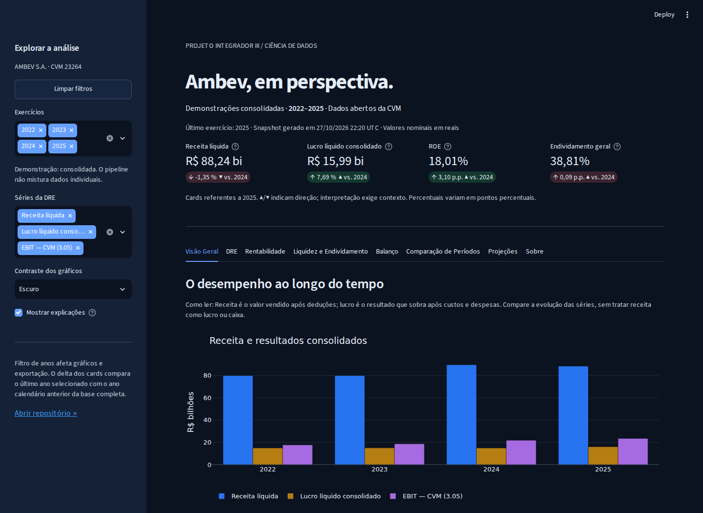
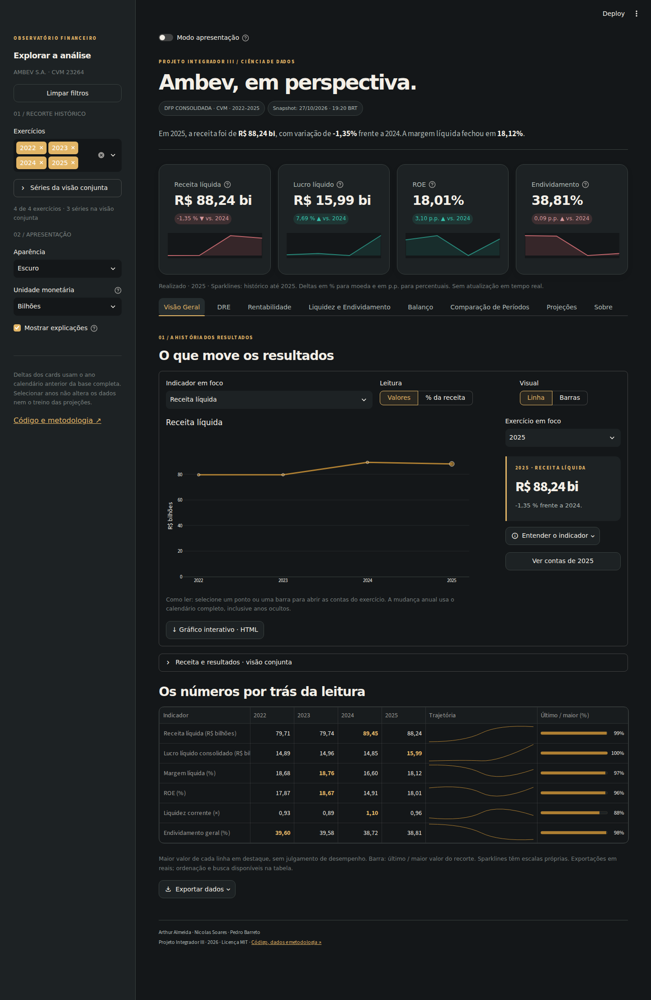
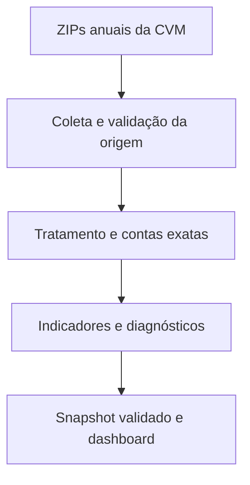
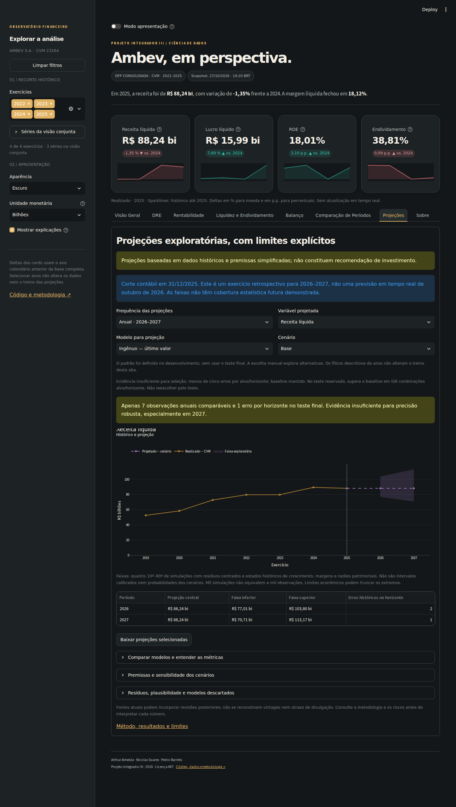

# Ambev, em perspectiva

**Projeto Integrador III · Ciência de Dados · Fatec Cotia**

Pipeline auditável em Python para analisar as Demonstrações Financeiras Padronizadas (DFP) **consolidadas da Ambev S.A.**, nos exercícios de **2022 a 2025**, e apresentar resultados em um dashboard Streamlit. A fonte é o portal de dados abertos da CVM; a seleção usa código CVM/CNPJ e códigos de contas, sem inferir valores pelo nome das contas.

[](https://github.com/soaresdossantosnicolas-wq/Projeto-Integrador-III-Analise-Financeira-Ambev/actions/workflows/quality.yml)


## Começar pelo dashboard

Requer **Python 3.12**. O snapshot validado está incluído: não é necessário baixar os ZIPs para abrir a aplicação.

```bash
git clone --branch feat https://github.com/soaresdossantosnicolas-wq/Projeto-Integrador-III-Analise-Financeira-Ambev.git
cd Projeto-Integrador-III-Analise-Financeira-Ambev
python -m venv .venv
```

Ative o ambiente:

```powershell
# Windows — PowerShell
.venv\Scripts\Activate.ps1
```

```bash
# Linux / macOS
source .venv/bin/activate
```

```bash
python -m pip install -r requirements.txt
python -m streamlit run code/04_visualizacao.py
```

Abra <http://localhost:8501>. As abas são **Visão Geral, DRE, Rentabilidade, Liquidez e Endividamento, Balanço, Comparação de Períodos, Projeções e Sobre**. O filtro de anos afeta gráficos e exportação; os cards comparam o último ano selecionado com o **ano calendário anterior da base completa**, inclusive se ele estiver oculto pelo filtro.

**Para quem está começando:** a opção “Mostrar explicações”, ativada por padrão na barra lateral, exibe guias curtos de leitura dos gráficos. Os ícones de ajuda dos cards explicam o significado e a fórmula. A aba Sobre reúne um glossário de todos os campos do snapshot, com exemplos hipotéticos e cuidados de interpretação. Ocultar os guias mantém o glossário, a ajuda e os avisos metodológicos disponíveis.

Não há URL de aplicativo público confirmada nesta revisão. Consulte as [instruções de publicação](docs/deploy.md). A licença e a identificação acadêmica estão no próprio dashboard.

## Explorar e compartilhar a análise

A identidade **Executivo moderno** usa grafite, âmbar e tipografia Manrope com fallback local. Os KPIs mostram sparklines, e a Visão Geral reúne indicador, gráfico e insight coordenados. Clique em um ponto ou use “Ver contas” para abrir o detalhamento do exercício.

- Alterne linha/barras, unidade monetária e % da receita; explore a DRE por cascata/mapa de calor e o balanço por composição.
- Compare dois exercícios explícitos e exporte o recorte em CSV/Excel ou o gráfico em HTML interativo.
- Copie a URL do navegador para compartilhar aba, filtros, indicador e cenário. O modo apresentação oculta os filtros laterais.
- As projeções continuam consumindo somente CSVs salvos. A mudança de design não altera os resultados financeiros.

## Capturas do dashboard real

**Antes**



**Depois**



Veja também a [Visão Geral clara](docs/img/depois/visao-geral-claro-desktop.webp), as versões para celular [escura](docs/img/depois/visao-geral-escuro-celular.webp) e [clara](docs/img/depois/visao-geral-claro-celular.webp), e a [DRE com análise vertical](docs/img/depois/02-dre.webp).

A [revisão de design](docs/design-dashboard.md) registra o diagnóstico, as duas direções propostas e a validação. A seleção em `docs/img/` contém **13 WebP sem perdas, 1,40 MB no total**, todos abaixo de 300 KB. A matriz completa e os complementos ficam no ZIP **local e não versionado** `outputs/dashboard-capturas-completas-2026-10-28.zip` (10,21 MB). Os PNGs removidos da árvore atual permanecem nos commits anteriores, pois o histórico foi preservado.

## Deploy no Streamlit Community Cloud

Use este repositório, branch **`feat`**, entrada **`code/04_visualizacao.py`** e Python **3.12**. As dependências estão em `requirements.txt`; mantenha os snapshots locais, `assets/` e `.streamlit/config.toml` no checkout. A abertura do dashboard não exige baixar ZIPs da CVM, executar modelos ou configurar credenciais.

As [instruções de deploy](docs/deploy.md) detalham a configuração. Não há URL pública de aplicativo confirmada: disponibilizar os commits no GitHub e publicar o aplicativo são etapas distintas. O envio desta revisão ao GitHub está pendente de DNS e autenticação SSH funcionais.

## Reproduzir o pipeline

Um comando executa as três etapas, interrompendo o fluxo diante de falhas:

```bash
python code/run_pipeline.py
```

```bash
# Sem acesso à rede: exige os quatro ZIPs em dados_cvm/
python code/run_pipeline.py --offline

# Reutiliza os CSVs já extraídos em saida/
python code/run_pipeline.py --sem-coleta
```

A ordem para execução individual é:

```bash
python code/analise_ambev_cvm.py
python code/02_tratamento_ambev.py
python code/03_analise_financeira.py
python -m streamlit run code/04_visualizacao.py
```

Em sistemas com GNU Make: `make pipeline`, `make offline`, `make dashboard` e `make check`. O Makefile é opcional; os comandos Python também funcionam no Windows.

## Origem e controles dos dados

- **CVM:** [DFP — Demonstrações Financeiras Padronizadas](https://dados.cvm.gov.br/dataset/cia_aberta-doc-dfp).
- **Empresa:** Ambev S.A., código CVM `23264`, CNPJ `07.526.557/0001-00`.
- **Conjunto:** DRE, BPA e BPP consolidados, exercícios anuais de janeiro a dezembro, última versão disponível de cada DFP.
- **Moeda:** `REAL`; `MIL` é convertido para reais exatamente uma vez. Nenhuma etapa usa valores de anos comparativos para preencher anos ausentes.
- **Conferência externa:** [RI da Ambev — Destaques Financeiros](https://ri.ambev.com.br/visao-geral/destaques-financeiros/), consultado em 27/10/2026. A referência congelada e a conciliação estão em `reports/validacao/`.

O pipeline valida integridade e membros dos ZIPs, `DT_REFER`, `DT_INI_EXERC`, `DT_FIM_EXERC`, `ORDEM_EXERC = ÚLTIMO`, empresa, consolidação, moeda, escala, versão, unicidade e identidades contábeis. Registros conflitantes causam erro, sem agregação por média ou escolha arbitrária. Veja a [política de dados e rastreabilidade](docs/dados.md).

## Arquitetura e estrutura



| Caminho | Responsabilidade |
|---|---|
| `code/analise_ambev_cvm.py` | Download, retries, cache, CRC e extração por ano |
| `code/cvm.py`, `code/excecoes.py` | Contrato dos dados e erros de domínio |
| `code/02_tratamento_ambev.py` | Seleção de contas, fallback explícito e identidades |
| `code/03_analise_financeira.py` | Indicadores, análises horizontal/vertical e diagnóstico de ausências |
| `code/config.py` | Período, mapas CVM, caminhos, autores, fórmulas e paleta |
| `code/04_visualizacao.py`, `code/dashboard_utils.py` | Interface e funções puras de apresentação |
| `dados_tratados/` | Snapshot do dashboard, metadados, proveniência e evidências de qualidade |
| `reports/validacao/` | Referência oficial, conciliação, downloads e varredura de segurança |
| `reports/historico/` | HTMLs antigos preservados; não são resultados atuais |
| `tests/` | Testes sintéticos, regressões financeiras, validação externa congelada e AppTest |
| `scripts/` | Conciliação, varredura de segredos e captura visual |
| `.streamlit/`, `.github/`, `docs/` | Tema, integração contínua e documentação |

A [arquitetura](docs/arquitetura.md) detalha os contratos e o comportamento de falha.

## Indicadores e unidades

| Indicador | Fórmula | Unidade |
|---|---|---|
| Liquidez corrente | Ativo circulante / passivo circulante | vezes |
| Liquidez seca | (Ativo circulante − estoques) / passivo circulante | vezes |
| Margem bruta | Lucro bruto / receita líquida × 100 | % |
| Margem operacional CVM | Resultado da conta 3.05 / receita líquida × 100 | % |
| Margem líquida | Lucro líquido consolidado / receita líquida × 100 | % |
| ROA | Lucro líquido consolidado / ativo total final × 100 | % |
| ROE | Lucro líquido consolidado / PL consolidado final × 100 | % |
| Endividamento geral | (PC + PNC) / ativo total × 100 | % |
| Capital de terceiros / PL | (PC + PNC) / patrimônio líquido × 100 | % |
| Crescimento / análise horizontal | (Atual − anterior) / valor absoluto do anterior × 100 | % |
| Análise vertical da DRE | Conta / receita líquida do mesmo ano × 100 | % da receita |

PC = passivo circulante; PNC = passivo não circulante. O código CVM `2` inclui o PL: não é o numerador do endividamento. Divisões por zero e ausências resultam em n/d, com motivo no diagnóstico. Crescimento exige anos consecutivos e não preenche valores ausentes. Diferenças de margens e retornos nos cards são apresentadas em **pontos percentuais**.

**Atenção ao EBIT:** a conta CVM `3.05` inclui equivalência patrimonial. O EBIT mostrado no RI a exclui. A conciliação subtrai `3.04.06` para comparar conceitos; o valor original da CVM é preservado. Veja [metodologia e limitações](docs/metodologia.md).

## Resultados verificados de exemplo

Valores monetários em R$ bilhões, arredondados apenas para exibição:

| Exercício | Receita líquida | Lucro líquido consolidado | Margem bruta | ROE | Endividamento geral |
|---|---|---|---|---|---|
| 2022 | 79,71 | 14,89 | 49,29% | 17,87% | 39,60% |
| 2023 | 79,74 | 14,96 | 50,72% | 18,67% | 39,58% |
| 2024 | 89,45 | 14,85 | 51,24% | 14,91% | 38,72% |
| 2025 | 88,24 | 15,99 | 51,42% | 18,01% | 38,81% |

A receita de R$ 89,45 bilhões pertence a **2024**, não a 2025. A receita de 2025 é R$ 88,24 bilhões. A proximidade das receitas de 2022 e 2023 é real, conforme a referência oficial consultada. Consulte a [revisão final](docs/revisao-final.md) para os resultados e limites de cada item A–J.

## Análise preditiva

**Revisão em 28/10/2026:** 77 testes aprovados e resultados numéricos reproduzidos sem alterações. A execução offline agora concilia os históricos anual/trimestral, os indicadores por fórmula e o estágio 3 antes de treinar. Veja o [diagnóstico e as evidências desta revisão](docs/auditoria-preditiva-2026-10-28.md), incluindo a conferência atual das referências publicadas pela Ambev e os limites da auditoria.

**Pergunta:** que trajetória os principais resultados e indicadores podem seguir em 2026–2027, e quanto confiar nessa projeção?

A nova camada auditou DFP/ITR de **2015–2025** (11 anos/44 trimestres) e adotou o corte **2019–2025** (7 anos/28 trimestres) após avaliar IFRS 16 e reapresentações. A DRE trimestral deriva dos acumulados e Q4 = anual − nove meses; balanços são saldos. O estágio 3 de 2022–2025 foi preservado.

O padrão anual é o **ingênuo**, por insuficiência de validação; o trimestral é o **ingênuo sazonal**, com menor MASE agregado de desenvolvimento que tendência, Holt e Holt-Winters. Alguns métodos anuais erraram menos no teste final, mas não foram escolhidos olhando esse resultado. ARIMA/SARIMA e ML complexo foram descartados pela amostra insuficiente sob o protocolo.

Validação por janelas expansivas, sem embaralhar, com reserva final 2024–2025 anual e 2025 trimestral. Há um erro por horizonte na reserva. MAE, RMSE, sMAPE/MAPE e MASE são salvos por modelo/alvo/horizonte. Cenários e faixas de bootstrap são exploratórios, **sem cobertura futura demonstrada**.

```bash
python code/05_modelagem_preditiva.py --offline
# Reconstruir dos arquivos CVM:
python code/05_modelagem_preditiva.py --preparar-dados
# Pipeline completo com camada opcional:
python code/run_pipeline.py --com-projecoes
python scripts/validar_preditiva.py
```

A aba **Projeções** lê `outputs/preditiva/`, sem treinar a cada interação. Exibe histórico, faixa de incerteza, modelos, cenários, premissas e sensibilidade. Statsmodels e dependências têm versões fixadas. Este é um estudo retrospectivo com corte contábil em 2025, não uma previsão em tempo real de outubro de 2026.

Limitações: amostra pequena, revisões posteriores, choques macroeconômicos, valores nominais e balanço aproximado por razões históricas. Identidades são preservadas, mas alternativas anuais e trimestrais não são reconciliadas automaticamente. As projeções não constituem recomendação de investimento.

- [Diagnóstico, método, backtest, projeções e interpretação para apresentação](docs/analise-preditiva.md)
- [Riscos e pendências a validar com o professor](docs/riscos-preditiva.md)
- Resultados e premissas: `outputs/preditiva/`
- [Captura atual da aba Projeções](docs/img/depois/07-projecoes.webp). As capturas completas, incluindo as anteriores, estão preservadas no ZIP local descrito acima.



## Testes e qualidade

```bash
python -m pip install -r requirements-dev.txt
python -m ruff check .
python -m pytest
python scripts/validar_referencia.py
python code/preparar_deploy.py
```

`requirements.in` registra as sete dependências diretas. `requirements.txt` fixa as 40 dependências de execução, incluindo as transitivas resolvidas no ambiente validado. Testes e Ruff ficam em `requirements-dev.txt`.

Os testes não dependem de acesso à internet: usam fixtures sintéticas com o schema da CVM e valores oficiais congelados. A integração contínua usa Python 3.12 e Ubuntu 24.04. A captura visual opcional gera telas do Streamlit real como artefato da execução do GitHub Actions; consulte [validação visual](docs/validacao-visual.md).

## Limitações

Quatro observações anuais, valores nominais sem correção monetária e análise estritamente descritiva. ROA e ROE usam saldos finais, não médios. O lucro consolidado inclui não controladores. Dívida financeira e EBITDA normalizado não são extraídos; os indicadores dependentes ficam n/d com justificativa. A CVM pode republicar arquivos: hashes e versões documentam a origem usada, mas não garantem downloads futuros idênticos. A tolerância contábil é o maior valor entre R$ 1.000 e 0,0001% do saldo de referência.

Não há recomendação de investimento, previsão de preço de ações ou inferência causal.

## Autores

**Arthur Almeida, Nicolas Soares e Pedro Barreto.**

Ciência de Dados · Fatec Cotia · Projeto Integrador III.

## Licença

Código sob [licença MIT](LICENSE). A licença do projeto não substitui as condições de uso dos dados públicos da CVM nem concede direitos sobre marcas de terceiros. O dashboard usa cabeçalho textual, sem logotipo da Ambev.
