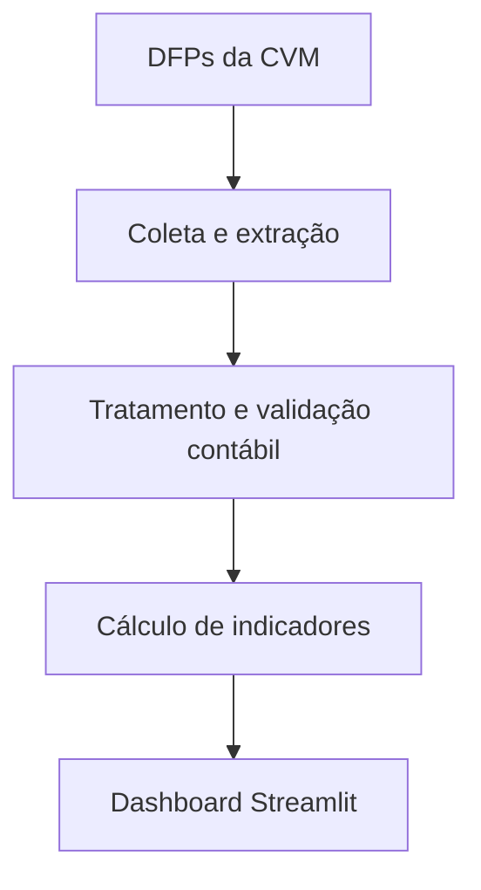

# Arquitetura

O projeto usa scripts sequenciais para um conjunto pequeno de observações anuais. O objetivo é manter o fluxo simples e reproduzível.

`code/config.py` concentra empresa, anos, plano de contas e caminhos. Os caminhos são resolvidos a partir da localização do código, independentemente do diretório de execução. Alterar o período também exige revisar os nomes de arquivos com `2022_2025`, os testes e os rótulos do dashboard; mudar somente `ANOS` não é suficiente.

`code/run_pipeline.py` executa as etapas em subprocessos com o mesmo interpretador Python, valida os scripts e as saídas esperadas e interrompe o fluxo se uma etapa falhar. `--sem-coleta` exige os CSVs anuais produzidos pela coleta. Use `--help` para consultar as opções.

O dashboard consome o snapshot de indicadores versionado. Bases tratadas auxiliares e entradas da coleta são regeneráveis; consulte [dados.md](dados.md).

Os scripts permanecem em `code/` e conservam seus nomes para manter compatibilidade com os comandos e o caminho do Streamlit Cloud. Uma futura migração para pacote instalável deve incluir um plano de compatibilidade dos pontos de entrada.
